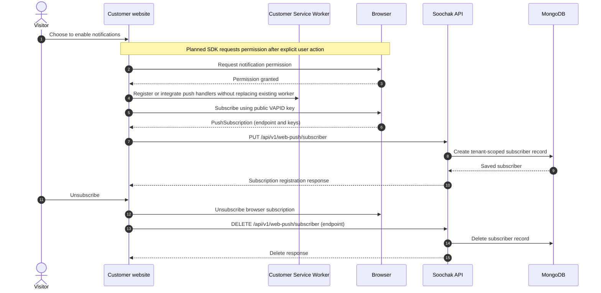

# Soochak Sequence Diagrams

These diagrams describe the target product flows alongside implementation boundaries. Dotted arrows and notes identify behavior that is planned or incomplete. The current API contract is documented in `codebase/backend/public/api-docs/openapi.yml`; the registration workflow below is a target, not a description of the current endpoint behavior.

## Public self-service registration and review

Public signup collects the customer's website origin separately from its Soochak dashboard/API tenant hostname. For hosted SaaS, the tenant hostname is a Soochak subdomain by default. Submission creates a pending organization and owner account without tenant dashboard/API access; operator approval and successful provisioning are both required before tenant access is enabled. Email notifications use the submitted contact address, but email ownership verification is deferred.

```mermaid
sequenceDiagram
    autonumber
    actor Owner
    participant Signup as Public signup
    participant API as Registration API
    participant DB as MongoDB
    participant Provision as Owner/access provisioning
    participant Mail as Email service
    participant Mgmt as Protected operator portal
    participant Operator
    participant Tenant as Tenant dashboard/API

    Owner->>Signup: Submit organization, customer website origin, owner details/password
    Signup--)API: Submit registration (target API contract; existing PUT route lacks review workflow)
    API->>DB: Create pending organization and owner account without tenant access
    API--)Provision: Create owner role and initial permission grants
    Provision-->>API: Report provisioning result
    API-->>Signup: Registration received; tenant access remains locked
    Signup-->>Owner: Show pending-review status
    API--)Mail: Send receipt/status email to submitted contact address

    Operator->>Mgmt: Open protected management portal
    Mgmt->>API: Load pending registration queue
    API->>DB: Read pending organization and provisioning state
    DB-->>API: Registration details/status
    API-->>Mgmt: Show review request
    alt Approve
        Operator->>Mgmt: Approve registration
        Mgmt->>API: Record approval
        API->>DB: Activate only if required provisioning succeeded
        API--)Mail: Send approval status
        Owner->>Tenant: Sign in with signup password
        Tenant-->>Owner: Grant access to tenant dashboard/API
    else Request changes
        Operator->>Mgmt: Request changes
        Mgmt->>API: Record requested changes and reason
        API--)Mail: Send status notice
        Owner->>Signup: Sign in with signup password
        Signup-->>Owner: Restricted registration area; no tenant access
        Owner->>Signup: Edit and resubmit registration
        Signup->>API: Save changes; return to pending review
    else Reject
        Operator->>Mgmt: Reject with reason
        Mgmt->>API: Record rejection and reason
        API--)Mail: Send rejection status
        Note over Owner,Signup: A rejected applicant must submit a new registration.
    end
```

## Direct organization creation by platform operator

This flow skips applicant review. The operator supplies an initial owner password outside the system; the owner must change it on first login. The initial password must never appear in application logs, URLs, or documentation.

```mermaid
sequenceDiagram
    autonumber
    actor Operator
    participant Mgmt as Protected operator portal
    participant API as Management API
    participant DB as MongoDB
    participant Provision as Owner/access provisioning
    participant Owner
    participant Tenant as Tenant dashboard/API

    Operator->>Mgmt: Enter organization, customer website origin, owner details, initial password
    Mgmt->>API: Create organization directly (no applicant review)
    API->>DB: Create pending-provisioning organization and owner
    API--)Provision: Create owner role and initial permission grants
    Provision->>DB: Store hashed credentials and access records
    Provision-->>API: Provisioning result
    alt Provisioning succeeds
        API->>DB: Activate organization and assign tenant dashboard/API host
        API-->>Mgmt: Organization active
        Operator-->>Owner: Communicate initial password outside the system
        Owner->>Tenant: Sign in
        Tenant-->>Owner: Require password change at first login
    else Provisioning fails
        API->>DB: Keep organization inactive and record provisioning failure
        API-->>Mgmt: Show failure; allow operator intervention/retry
    end
```

The operator portal is hosted at `mgmt.soochak.optiwari.duckdns.org` in local development and `mgmt.soochak.bizbandhan.com` in production. Tenant dashboard/API hosts use `[tenant].soochak.optiwari.duckdns.org` locally and `[tenant].soochak.bizbandhan.com` in production. Custom dashboard domains, email/hostname ownership verification, and plan payments are deferred. Self-hosted installations are a separate deployment path; central configuration/update synchronization is later-stage.

## Website subscription lifecycle

The browser-side SDK and consent UX are planned. The backend currently exposes subscriber CRUD routes under `/api/v1/web-push/subscriber`; the customer website must integrate with its own Service Worker, preserving existing worker behavior.



## Notification send and browser display

`PUT /api/v1/web-push/notify` currently lists subscribers, emits an in-process delivery event, creates a notification record, and returns. Delivery is not durable or tracked: NATS/workers, notification history/outcome APIs, and confirmed display/click analytics are future work. A successful API response means accepted by the current prototype flow, not delivered or displayed.

```mermaid
sequenceDiagram
    autonumber
    actor Operator
    participant Dashboard
    participant API as Express API
    participant Subscribers as Subscriber controller
    participant DB as MongoDB
    participant Events as In-process event stream
    participant Sender as Web Push sender
    participant Push as Browser push service
    participant SW as Customer Service Worker
    participant Browser

    Operator->>Dashboard: Compose and confirm notification
    Dashboard->>API: PUT /api/v1/web-push/notify (title, body, url, tag)
    API->>Subscribers: List subscribers in request-origin scope
    Subscribers->>DB: Query subscriber records
    DB-->>Subscribers: Matching subscribers
    Subscribers-->>API: Subscriber list
    API--)Events: Emit notify-web-push with payload, VAPID config, subscribers
    API->>DB: Create notification record
    DB-->>API: Created notification
    API-->>Dashboard: Accepted response
    Dashboard-->>Operator: Show accepted, not delivered

    Events--)Sender: Process delivery event
    loop Each subscriber
        Sender->>Push: Send Web Push payload
        Push-->>SW: Deliver push event when browser is reachable
        SW->>Browser: Display notification
        Browser-->>SW: User clicks notification (optional)
        SW->>Browser: Open configured destination (optional)
    end
    Note over Sender,Push: Current sender uses an in-process event and Promise.all; durable queueing, per-recipient outcomes, retries, and history are not implemented.
```

## Current boundaries

- The target hosted model assigns each organization a Soochak tenant dashboard/API subdomain. The current backend instead derives scope from the request hostname and still needs tenant-host-aware authorization.
- Login, complete authorization, and provisioning-status/recovery are not complete. Email and hostname ownership verification are deferred from initial activation.
- Subscriber routes exist, but the SDK/consent lifecycle and end-to-end subscription flow still need implementation and verification.
- NATS JetStream and separate workers are planned architecture, not part of the current deployment.
- The dashboard's PWA Service Worker is for the dashboard origin; it is not the Service Worker used by customer websites.
